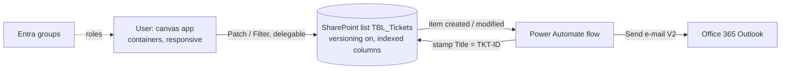

# Enterprise Ticket Management System (Power Apps + SharePoint + Power Automate)

A responsive **canvas app** for internal requests (IT, HR, Facilities, Management) backed by a **SharePoint Online list**, with a ticket status lifecycle and automatic closing timestamps, delegation-safe filtering, flow-based e-mail notifications and an application lifecycle management (ALM) path. The repository contains the data schema, the Power Fx formulas, a provisioning script, a Power Automate specification and a review of common pitfalls this design deliberately avoids.

## Table of contents
[Status](#project-status-and-scope) · [Problem](#business-problem) · [Architecture](#architecture) · [Data schema](#data-schema) · [Lifecycle](#ticket-lifecycle) · [UI design](#user-interface) · [Concepts explained](#engineering-concepts-explained) · [Structure](#repository-structure) · [Build it](#build-it) · [Testing](#testing-and-ci) · [Limitations](#limitations-and-next-steps) · [Glossary](#glossary)

## Project status and scope
- **What this is:** the complete design artifacts: schema, Power Fx for each property that needs logic, SharePoint provisioning script (PnP PowerShell), flow specification, ALM guidance, and a seed-data generator.
- **Runs locally and in CI on every push:** the seed-data generator and tests that check lifecycle rules and the "stale ticket" logic.
- **Built in Power Apps/Power Automate:** the app (`.msapp`) and flow are not committed as binary exports; the formulas and specifications are written to be pasted into Power Apps Studio and the flow designer.
- **History:** the first prototype used session-based collections (data lost on refresh, one user at a time). This design replaces that with a central SharePoint backend.

## Business problem
Teams track requests in local, per-session collections: records disappear when the app restarts, concurrent users can't share state, and nothing records who changed what and when. The organisation needs a single authoritative ticket store, a mobile- and desktop-friendly interface, an enforced status lifecycle with audit timestamps, and notifications in the tools people already use (Outlook).

## Architecture


## Data schema
List `TBL_Tickets` (created by `sharepoint/provision_list.ps1`).
| Column | Type | Notes |
|---|---|---|
| Title | Text (required by SharePoint) | set to `TKT-<ID>` by the flow |
| IndexID | Number | optional business-visible number |
| Department | Choice | IT, HR, Facilities, Management (indexed) |
| AssignedTo, Owner | Text | staff member / requester |
| Subject, Description, Comment | Multi-line text | summary, details, internal notes |
| Status | Choice | New, In Progress, On Hold, Closed (indexed) |
| Priority | Choice | Low, Medium, High |
| DateClosed | Date/time | set only on closure |
| ID, Created, Modified | system columns | creation time comes from `Created`, which cannot be tampered with |

## Ticket lifecycle
`New → In Progress ⇄ On Hold → Closed`. On save, `DateClosed` is stamped when Status becomes Closed and cleared if the ticket is reopened (`powerfx/Save_OnSelect.fx`). SharePoint version history provides the audit trail.

## User interface
Container hierarchy for responsive layout (`powerfx/Layout_Responsive.fx`): a fixed-height header (80 px, Y = 0); a body container sized `Parent.Height − Self.Y`; inside it, a card container (~25% height) with status counts, a filter sidebar (25% width) and the main gallery (75% width). Separator rectangles divide sidebar and gallery and individual rows. The status bar colour mapping (`powerfx/Status_Color.fx`): New = blue, In Progress = amber, Closed = green, On Hold = red, with text alongside colour for accessibility. Gallery views: by status, by department, **stale** (open and created 3+ days ago) and **today**.

## Engineering concepts explained
**Delegation.** Power Apps can only filter very large lists on the server if each function is *delegable*; otherwise it silently processes just the first 500-2,000 rows. `Gallery_Items.fx` uses only delegable predicates (`Status.Value = …`, `Created <= DateAdd(Today(), -3, TimeUnit.Days)`), and avoids `DateDiff`, which SharePoint cannot evaluate.

**Create vs update.** Creating uses `Patch(TBL_Tickets, Defaults(TBL_Tickets), {...})`; updating patches the *existing* record (`LookUp(TBL_Tickets, ID = varSelected.ID)`). Using `Defaults()` for an update inserts a duplicate row every save. `IfError` ensures the success message only appears after the write succeeds.

**Race-free identifiers.** Computing "max index + 1" in the app lets two simultaneous users receive the same number. This design uses SharePoint's `ID` (shown as `TKT-<ID>`), which the service assigns atomically.

**Server-side notifications.** A Power Automate flow triggered by SharePoint sends the e-mail under a service identity with run history and retries, instead of from each user's session; a trigger condition prevents the flow from re-triggering itself (`alm/FLOW_NOTIFY.md`).

**Provisioning as code.** `provision_list.ps1` creates the list, columns, versioning and indexes (Status, Department) so the app keeps working when the list grows.

**Roles.** Requesters see their own tickets, agents their department's, managers all, driven by Entra groups and an environment variable for the manager group (no IDs hardcoded).

**ALM.** Put the app and flow in a solution with connection references and environment variables; promote Dev → Test → Prod; unpack for Git with the Power Platform CLI; test with Test Studio (`alm/ALM.md`).

## Common pitfalls this design avoids
`docs/KNOWN_ISSUES_AND_FIXES.md` lists ten (for example full-list `ClearCollect` copies hitting the row limit, `Patch` with `Defaults()` on update, non-delegable date filters, client-side e-mail, hand-rolled IDs) with the approach used here for each.

## Repository structure
```
├── powerfx/                  # App_OnStart · Gallery_Items · Save_OnSelect · Status_Color · Layout_Responsive
├── sharepoint/provision_list.ps1
├── seed/generate_seed_tickets.py
├── alm/                      # FLOW_NOTIFY.md · ALM.md
├── docs/                     # SOLUTION_ARCHITECTURE.md · KNOWN_ISSUES_AND_FIXES.md
├── tests/test_seed.py
└── .github/workflows/ci.yml
```

## Build it
Prerequisites: a Microsoft 365 tenant with Power Apps (the free Microsoft 365 Developer Program sandbox works) and PowerShell with PnP.PowerShell.
1. `./sharepoint/provision_list.ps1 -SiteUrl https://<tenant>.sharepoint.com/sites/<site>`
2. `python seed/generate_seed_tickets.py --n 40`, then import `seed/tickets.csv` into the list (use `--n 5000` to test delegation at scale).
3. Create a canvas app, add `TBL_Tickets` as a data source, and paste the formulas from `powerfx/` into the matching properties.
4. Build the flow from `alm/FLOW_NOTIFY.md`.

## Testing and CI
Tests confirm every Closed ticket has a `DateClosed` between its creation and today, open tickets have none, ticket titles are unique, and the stale-ticket rule (created 3+ days ago and not closed) selects only open tickets. GitHub Actions byte-compiles and runs them on each push.

## Limitations and next steps
- App and flow exports are not committed; formulas and specs are provided instead.
- Add SLA timers (due dates by priority), attachments and a Power BI report on ticket throughput.

## Glossary
**Canvas app:** Power Apps app built by placing controls on a screen. **Power Fx:** Power Apps' formula language. **Delegation:** pushing filter/sort work to the data source. **Patch:** function that creates or modifies records. **ALM:** application lifecycle management. **Environment variable:** per-environment setting stored in a solution.
